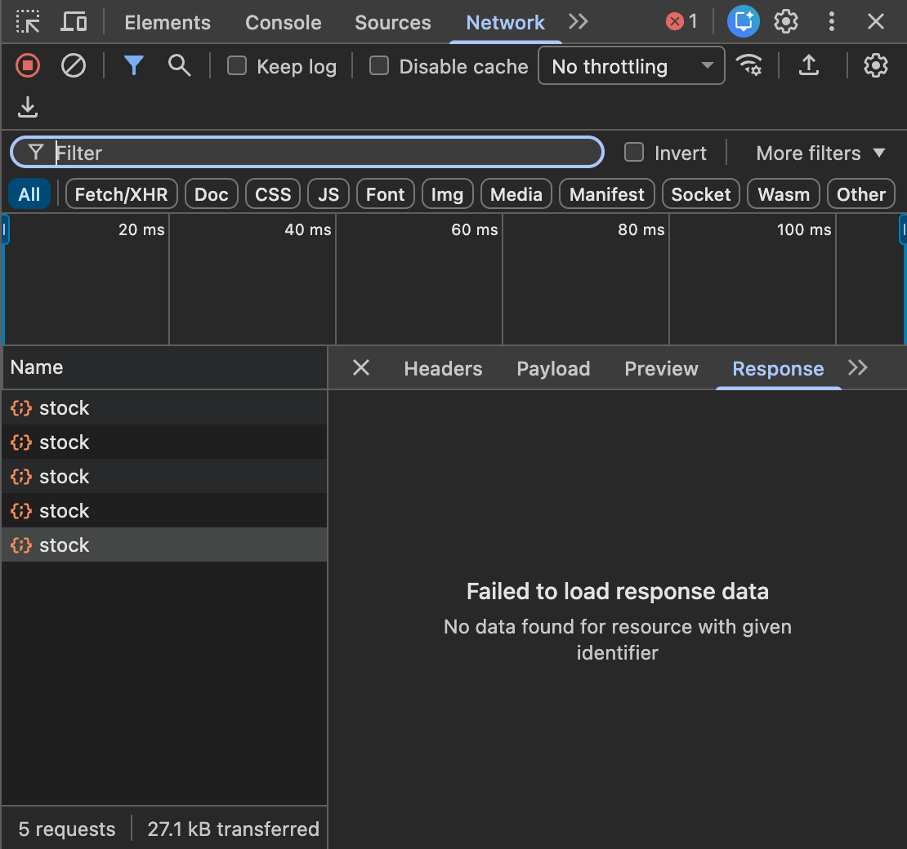

# Repro for crbug.com/455600248: DevTools "Failed to load response data" for fetch()

Issue: https://issues.chromium.org/issues/455600248

Chrome DevTools shows **"Failed to load response data: No data found for resource with given
identifier"** for successful (`200`) `fetch()` requests when all three of these hold:

1. the body is read through **`response.body.getReader()`** (a ReadableStream),
2. the response has **`Cache-Control: no-store`**,
3. the body arrives **in more than one piece**.

The page receives the complete body. DevTools gets `Network.loadingFailed` with `canceled: true`
and never gets `Network.loadingFinished`.

An Angular app with `provideHttpClient(withFetch())` talking to a Spring Boot backend meets all three:

- Angular's `FetchBackend` reads every response with `response.body.getReader()` (to support
  progress events). Fetch is the default `HttpClient` backend since Angular 22.
- Spring Security adds `Cache-Control: no-cache, no-store, max-age=0, must-revalidate` to every
  response by default.
- Tomcat sends larger JSON responses in several chunks while Jackson is still writing.

If the whole body arrives at once, it only fails now and then. That's why it looked random in the
original report.



## Run it

Needs Node 22 or newer. There are no dependencies.

```bash
git clone https://github.com/swordmangofar/chromium-455600248-repro
cd chromium-455600248-repro
node server.mjs
```

1. Open http://localhost:8080 in Chrome.
2. Open DevTools → **Network**.
3. Click **fetch() + body.getReader()**.
4. Select the `stock` request → **Response** or **Preview**.

The control buttons send the same request but with a cacheable response, read it with
`response.json()`, or use `XMLHttpRequest`. DevTools shows the body for all of them.

The server (`server.mjs`) sends the response headers from the original report. It writes the
JSON body in 32 pieces 1 ms apart. Query parameters such as `?chunks=1` or `?nostore=0` on the page
URL are passed through to the API request.

### Angular version

`angular-app/` is Angular **20.3.13** with
`provideHttpClient(withInterceptorsFromDi(), withFetch())`, as in the original report. Its dev
server proxies `/api` to `server.mjs`, which has to be running.

```bash
cd angular-app
npm install
npm start
```

Open http://localhost:4200 and click **POST /api/b2b/v2/stock**. To run the same app with the XHR
backend (without `withFetch()`), open http://localhost:4200/?xhr instead.

### Automated check

`verify.mjs` launches Chrome and enables the DevTools `Network` domain, the same way the Network
panel does. It sends requests, then asks for each body with `Network.getResponseBody`, which is
what the Response tab calls. It has no dependencies.

```bash
node verify.mjs                          # plain page: the bug and 3 controls
```

```bash
node verify.mjs --url http://localhost:4200/ --trigger "document.querySelector('#load').click()"
```

```bash
CHROME="/path/to/chrome-or-chromium" node verify.mjs --runs 50 --headful
```

## Results

5 Nov 2026, macOS 27 (arm64), 30 requests per row, "missing" = `Network.getResponseBody` failed with
*"No data found for resource with given identifier"*.

| Variant | Chrome 152.0.7977.83 | Chrome for Testing 156.0.8078.4 | Brave (Chromium 156.0.8078.80) |
|---|---|---|---|
| **fetch + `getReader()`, `no-store`** | **29/30 missing** | **28/30 missing** | **30/30 missing** |
| same, response without `no-store` | 0/30 | 0/30 | 0/30 |
| same request, `response.json()` | 0/30 | 0/30 | 0/30 |
| `XMLHttpRequest` | 0/30 | 0/30 | 0/30 |
| **Angular 20.3.13, `withFetch()`** | **30/30 missing** | | |
| Angular 20.3.13, XHR backend | 0/30 | | |

Other findings:

- With the body sent in one piece (`?chunks=1`), only about 2–8% of requests fail. This matches
  the "random" behavior in the original report.
- `response.text()` and `response.arrayBuffer()` are not affected either.
- `AbortController` plays no part. The page never calls `abort()`.
  Angular ≤ 22.1.2 calls `abort()` after every completed fetch
  ([angular/angular#70071](https://github.com/angular/angular/issues/70071), fixed in 22.1.3), but
  that fix does not help here. On a comment there, users on 22.1.5 still see the problem.
- Resource Timing entries look normal (status 200, full `encodedBodySize`), and the page gets the
  whole body.

## What happens

- **Protocol:** `Network.responseReceived` (200) → `Network.dataReceived` … →
  `Network.loadingFailed { canceled: true }`. There is no `Network.loadingFinished`, so
  `Network.getResponseBody` returns *"No data found for resource with given identifier"*. The real
  DevTools front-end marks the request `failed` and `canceled` (screenshot above).
- **The load is cancelled even with DevTools closed.** A trace with the `blink` category, without
  the Network domain enabled, shows `ResponseBodyLoader::DidCancelLoadingBody` for 10/10 fetch +
  reader requests. XHR and `response.json()` end in `ResponseBodyLoader::DidFinishLoadingBody`.
  Per request the order is `URLLoader::Context::OnCompletedRequest` →
  `ResponseBodyLoader::DidCancelLoadingBody` → `URLLoader::Context::Cancel`.

Likely code path (Chromium `main`, November 2026). This comes from reading the code and has not
been confirmed with a debugger:

- `FetchManager::Loader::DidStartLoadingResponseBody()` wraps the body in a
  `BufferingBytesConsumer` unless the response is `no-store` (or the request has `integrity`). With
  `no-store`, `BodyStreamBuffer` reads directly from `ResponseBodyLoader`'s
  `DelegatingBytesConsumer`. This explains why `no-store` matters.
- Completion arrives as `DelegatingBytesConsumer::CancelSync()` →
  `ResponseBodyLoader::DidCancelLoadingBody()` → `ResourceLoader::Cancel()`, instead of
  `DidFinishLoadingBody()`. This is probably `BodyStreamBuffer::Close()` → `CancelConsumer()`
  cancelling the consumer before the "done" state reached it.
- `InspectorNetworkAgent::DidFailLoading()` does not call `MaybeDecodeDataToContent()`. Only
  `DidFinishLoading()` does, so the bytes DevTools has already buffered never become the response
  body.

## Workarounds until it's fixed

- **Angular:** remove `withFetch()`, or use `withXhr()` on Angular 22+.
- **Backend, dev profile only:** don't send `no-store` on API responses. With Spring Security:
  `http.headers(h -> h.cacheControl(c -> c.disable()))`.
- **Own code:** read with `response.json()` / `.text()` instead of a stream reader.

## Files

| File | |
|---|---|
| `server.mjs` | Backend: same headers as Spring Boot + Spring Security, body sent in pieces, serves the page |
| `public/index.html` | Repro page without a framework, with the bug and 3 controls |
| `verify.mjs` | Automated check through the Chrome DevTools Protocol |
| `angular-app/` | Angular 20.3.13 app with `withFetch()`, dev-server proxy to `server.mjs` |
| `devtools-response-tab.png` | Screenshot from Chrome 152 |
